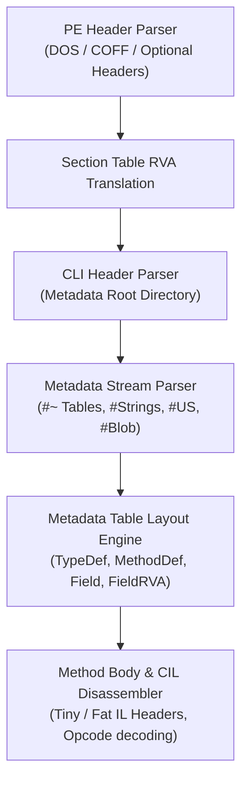

# Captain's Last Assembly: Sector 7 Protocol — Writeup

**Event:** CTF Challenge Writeup  
**Team:** ETC (Ethical Coders)  
**Category:** Reverse Engineering (Unity / .NET)  
**Points:** 500  
**Flag:** `ICTF{QUANTUM_COLLISION_GATEWAY_BYPASS}`  

---

## 🎮 Challenge Summary

The challenge distributes a Unity standalone build consisting of `CaptainsLastAssembly.exe` and its runtime directory `CaptainsLastAssembly_Data/`. 

Inside the game environment, an access terminal demands:
- **Level 5 Biometric Authorization**
- **1,000,000 Clearance Credits** to enter Sector 7

Clearance credits passively accumulate at a rate of 1 credit per 60 seconds (~694 days of continuous runtime required to accumulate legitimately). Rather than grinding gameplay, the objective is to reverse engineer the compiled managed game assemblies and extract the secret logic.

---

## 🔍 Technical Analysis & Reverse Engineering

### Step 1 — Locating Compiled Game Logic

In standard Unity Mono builds, all game and security logic compiles into a single managed assembly located at:

```text
CaptainsLastAssembly_Data/Managed/Assembly-CSharp.dll
```

This assembly encapsulates all clearance validations, terminal logic, credit counters, and flag routines.

---

### Step 2 — Custom ECMA-335 / IL Parser Architecture

In constrained analysis environments lacking decompilation tools (such as dnSpy, ILSpy, monodis, or pythonnet) or external internet access, a purpose-built **ECMA-335 CLI metadata and IL disassembler** was written in Python from scratch:



1. **PE Header Parsing**: Evaluated DOS/COFF/Optional headers and section headers to resolve Relative Virtual Addresses (RVA) to file offsets.
2. **CLI Header Parsing**: Located the `.NET` runtime metadata header via the CLI Data Directory.
3. **Metadata Stream Decoders**: Parsed stream headers for `#~` (compressed tables), `#Strings`, `#US` (User Strings), `#GUID`, and `#Blob`.
4. **Table Row Layout Engine**: Computed table schemas for `TypeDef`, `MethodDef`, `Field`, `FieldRVA`, and `MemberRef` based on heap sizes and coded index tag widths.
5. **CIL Opcode Disassembly**: Built an opcode table covering single-byte and `0xFE` prefix instructions, resolving string tokens from `#US` and method tokens from metadata tables.

---

### Step 3 — Target Class Enumeration

Enumerating `TypeDef` metadata surfaced two critical classes:

```csharp
FacilitySecurity
  - Fields: PlayerCredits, RequiredCredits, BiometricConfirmed
  - Methods: ValidateAccessClearance(), RequestCreditGrant()

VaultCoreTerminal
  - Fields: IsVaultBreached, DecryptedFlag, BreachTimestamp, EncryptedPayload, CipherKey
  - Methods: DecryptFlag(), CheckProximity(), TriggerBreach()
```

`VaultCoreTerminal` directly owns the flag. Rather than querying an external verification server, the flag resides directly inside the binary in an encrypted format and is decrypted locally on demand.

---

### Step 4 — Disassembling `DecryptFlag()`

Disassembling the IL instructions of `DecryptFlag()` revealed a repeating-key XOR stream cipher:

```cil
IL_0017: ldsfld Field:EncryptedPayload
IL_001c: ldlen
...
IL_002b: ldsfld Field:EncryptedPayload
IL_0030: ldloc.1
IL_0031: ldelem.u1          ; payload[i]
IL_0032: ldsfld Field:CipherKey
IL_0037: ldloc.1
IL_0038: ldsfld Field:CipherKey
IL_003d: ldlen
IL_003e: conv.i4
IL_003f: rem                ; i % key.Length
IL_0040: ldelem.u1          ; key[i % key.Length]
IL_0041: xor                ; payload[i] ^ key[i % key.Length]
IL_0042: conv.u2
IL_0043: stelem.i2          ; build char array -> string
```

**Cryptographic Relation**:
$$\text{Flag}[i] = \text{EncryptedPayload}[i] \oplus \text{CipherKey}[i \pmod{\text{CipherKey.Length}}]$$

---

### Step 5 — Static Data Extraction via `FieldRVA`

Both static byte arrays are initialized inside static constructor `VaultCoreTerminal..cctor` using compiler-generated synthetic fields in `<PrivateImplementationDetails>`:

```cil
IL_001a: ldc.i4.s 38
IL_001c: newarr TypeRef:Byte
IL_0022: ldtoken Field:$$method0x6000029-1   ; 38-byte blob -> EncryptedPayload
IL_002c: stsfld Field:EncryptedPayload

IL_0031: ldc.i4.7
IL_0032: newarr TypeRef:Byte
IL_0038: ldtoken Field:$$method0x6000029-2   ;  7-byte blob -> CipherKey
IL_0042: stsfld Field:CipherKey
```

Resolving field tokens against the `FieldRVA` table and extracting the raw file offsets yields:

* **`EncryptedPayload`** (38 bytes, hex):
  ```text
  1a061712340362120b1701020d741c090f1d1c1b781d1a04151b1760121c1c1616027600163e
  ```
* **`CipherKey`** (7 bytes, ASCII):
  ```text
  53 45 43 54 4f 52 37  -->  "SECTOR7"
  ```

---

### Step 6 — Decryption & Flag Extraction

```python
payload = bytes.fromhex("1a061712340362120b1701020d741c090f1d1c1b781d1a04151b1760121c1c1616027600163e")
key = b"SECTOR7"

flag = bytes(payload[i] ^ key[i % len(key)] for i in range(len(payload)))
print(flag.decode('utf-8'))
```

---

## 🚩 Flag

```text
ICTF{QUANTUM_COLLISION_GATEWAY_BYPASS}
```

---

## 💡 Key Takeaways

- **Client-Side Cryptography Flaws**: Storing encrypted confidential data alongside the decryption key inside client assemblies provides zero security against static reverse engineering.
- **Standalone ECMA-335 Tooling**: In environments where decompilers are unavailable, understanding the PE/COFF structure and CLI table streams allows surgically extracting IL bytecodes and static field data with pure standard library scripts.

