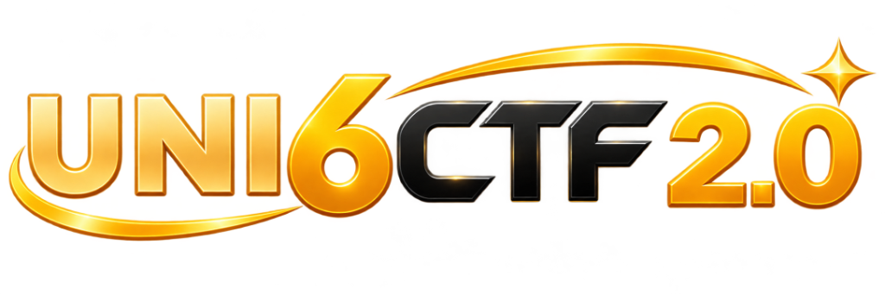
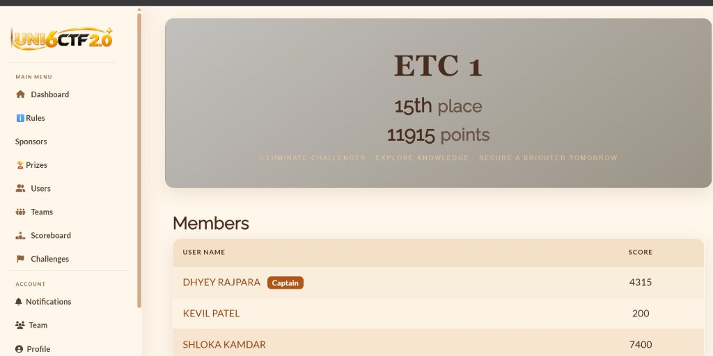
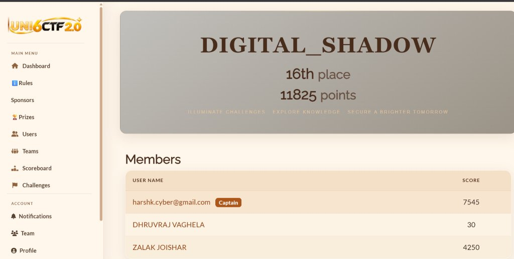

<p align="center">
  
</p>

<h1 align="center">UNI6CTF 2.0 (Diwali Edition) — CTF Writeups & Team Showcase</h1>

<p align="center">
  <strong>ETC (Ethical Coders) Dual-Team Competition Showcase</strong><br>
  <em>Two competitive sub-teams, six ethical hackers, top-tier leaderboard finishes.</em>
</p>

<p align="center">
  
  
  
  
</p>

---

## 🏆 Leaderboard & Team Performance

During **UNI6CTF 2.0 (Diwali Edition)**, members of **ETC (Ethical Coders)** competed across two distinct squads—**ETC 1** and **DIGITAL_SHADOW**—securing back-to-back **15th** and **16th** positions on the global leaderboard with a combined haul of **23,740 points**.

<table align="center" width="100%">
  <tr>
    <td align="center" width="50%" valign="top">
      <h3>🥇 ETC 1 (15th Place — 11,915 pts)</h3>
      <br><br>
      <table>
        <thead>
          <tr>
            <th>Member</th>
            <th>Role</th>
            <th align="right">Individual Score</th>
          </tr>
        </thead>
        <tbody>
          <tr>
            <td><strong>Dhyey Rajpara</strong></td>
            <td><code>Captain</code> · Web Security</td>
            <td align="right"><strong>4,315 pts</strong></td>
          </tr>
          <tr>
            <td><strong>Shloka Kamdar</strong></td>
            <td>Cryptography<br><code>🏆 BEST FEMALE CTF PLAYER</code></td>
            <td align="right"><strong>7,400 pts</strong></td>
          </tr>
          <tr>
            <td><strong>Kevil Patel</strong></td>
            <td>Software Analysis</td>
            <td align="right"><strong>200 pts</strong></td>
          </tr>
          <tr>
            <td colspan="2"><strong>Team Total</strong></td>
            <td align="right"><strong>11,915 pts</strong></td>
          </tr>
        </tbody>
      </table>
    </td>
    <td align="center" width="50%" valign="top">
      <h3>🥈 DIGITAL_SHADOW (16th Place — 11,825 pts)</h3>
      <br><br>
      <table>
        <thead>
          <tr>
            <th>Member</th>
            <th>Role</th>
            <th align="right">Individual Score</th>
          </tr>
        </thead>
        <tbody>
          <tr>
            <td><strong>Harsh Kanojia</strong></td>
            <td><code>Captain</code> · Team Lead / Linux</td>
            <td align="right"><strong>7,545 pts</strong></td>
          </tr>
          <tr>
            <td><strong>Zalak Joishar</strong></td>
            <td>Digital Forensics</td>
            <td align="right"><strong>4,250 pts</strong></td>
          </tr>
          <tr>
            <td><strong>Dhruvraj Vaghela</strong></td>
            <td>Research & Recon</td>
            <td align="right"><strong>30 pts</strong></td>
          </tr>
          <tr>
            <td colspan="2"><strong>Team Total</strong></td>
            <td align="right"><strong>11,825 pts</strong></td>
          </tr>
        </tbody>
      </table>
    </td>
  </tr>
</table>

> [!TIP]
> ### 🌟 Special Recognition: Best Female CTF Player — Shloka Kamdar
> **Shloka Kamdar** achieved the prestigious title of **Best Female CTF Player** in **UNI6CTF 2.0 (Diwali Edition)**, securing **7,400 points solo** (contributing over 62% of ETC 1's total 11,915 points)! Her mastery of advanced cryptography and forensics was a cornerstone of ETC's leaderboard success.

---

## 📚 Challenge Index & Writeups

Below is the directory of challenges solved and documented from UNI6CTF 2.0:

| Challenge | Category | Solved Flag | Key Concepts & Techniques | Writeup |
| :--- | :---: | :--- | :--- | :---: |
| **Digital Shadow** | OSINT | `UNI6CTF{Expl0it3rs_d1g1t4l_f00tpr1nt_1s_n3v3r_s4f3_bUt_g00d}` | Digital footprint tracing across GitHub commits, LinkedIn experience, and shortened X (Twitter) links | [Read Guide ↗](Digital_Shadow_Writeup.md) |
| **Direct0ry** | Web / Recon | `UNI6CTF{R0B0TS_H1D3_TH3_S1GN4L}` | 100-node crawler enumeration, nested `robots.txt` traversal, payload sequencing & decoy filtering | [Read Guide ↗](Direct0ry_Writeup.md) |
| **LeafDisk** | Forensics | `UNI6CTF{d3l3t3d_k3ys_n3v3r_d13_th3_xattr_r3m3mb3rs}` | ext4 filesystem analysis, `debugfs` undelete, AES-256 decryption, ext4 extended attributes (`xattr`) | [Read Guide ↗](LeafDisk_Writeup.md) |
| **The Final Confession** | OSINT | `UNI6CTF{disk_metadata.txt}` | PROJECT PHANTOM case investigation, typographical link repair, evidence manifest hierarchy | [Read Guide ↗](The_Final_Confession_Writeup.md) |
| **UNBLUR .me** | Misc | `UNI6CTF{f94708528f5f6fabd3435e146568544407cc15141a34abdf8ecaaa31bb3580d2}` | Sponsor page reconnaissance, anti-preview visual bait avoidance, PNG `tEXt` Comment chunk extraction | [Read Guide ↗](UNBLUR_me_Writeup.md) |
| **Vault Heist** | Forensics / Web | `UNI6CTF{sl0w_dr1p_bl1nd_sqli_l0g_h4unt3r_7c2e}` | 4,700-line web log triage, distinguishing loud sqlmap decoy from distributed blind SQLi, Python oracle solver | [Read Guide ↗](Vault_Heist_Writeup.md) |
| **Captain's Last Assembly** | Reverse Engineering | `ICTF{QUANTUM_COLLISION_GATEWAY_BYPASS}` | Unity Mono .NET reversing, custom pure-Python ECMA-335 IL disassembler, FieldRVA XOR cipher extraction | [Read Guide ↗](Captains_Last_Assembly_Writeup.md) |

---

## 📁 Directory Structure

```text
UNI-6-CTF(DIWALI EDITION)/
├── README.md                           # Master Showcase & Challenge Index
├── Captains_Last_Assembly_Writeup.md   # Unity .NET Reverse Engineering Walkthrough
├── Digital_Shadow_Writeup.md           # OSINT Digital Footprint Walkthrough
├── Direct0ry_Writeup.md                # Web Crawler & Robots.txt Reconstruction
├── Direct0ry_Writeup.pdf               # Original PDF Document
├── LeafDisk_Writeup.md                 # ext4 Forensics & Key Carving Walkthrough
├── The_Final_Confession_Writeup.md     # OSINT Scenario Investigation
├── UNBLUR_me_Writeup.md                # Misc Steganography & Chunk Extraction
├── Vault_Heist_Writeup.md              # Log Analysis & Blind SQLi Solver
└── assets/
    └── images/
        ├── logo.png                    # Official UNI6CTF 2.0 Logo
        ├── etc1_scoreboard.jpg         # ETC 1 15th Place Official Scoreboard
        ├── digital_shadow_scoreboard.jpg # DIGITAL_SHADOW 16th Place Official Scoreboard
        └── shloka_best_female_player.png # Best Female CTF Player Official Recognition
```

---

## 🎯 Technical Highlights & Lessons Learned

1. **Defeating Multi-IP Blind SQLi**:
   In *Vault Heist*, traditional single-IP thresholds failed to catch the adversary because requests were divided across 6 nodes. Correlating payload semantics across log streams revealed the binary search pattern.
2. **Beyond Surface Metadata**:
   In *UNBLUR .me* and *LeafDisk*, visible strings served as intentional honeypots. True flags required carving deleted inodes, reading ext4 extended attributes (`user.leaf`), and decoding raw PNG ancillary chunks.
3. **Collaborative Team Strategy**:
   By dividing into two focused squads (**ETC 1** and **DIGITAL_SHADOW**), ETC maximized specialized coverage across Cryptography, Web Security, Linux Systems, and Forensics.

---

<p align="center">
  <sub>Documented with pride by <strong>ETC (Ethical Coders)</strong> · 2026</sub>
</p>

